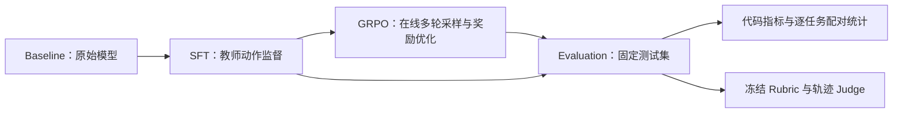

# 面向长程购物 Agent 的可复现后训练与评测（Agentic RL）

**简体中文** · [English](README.en.md)

基于 **Qwen3.5-2B** 和 ShopSimulator，复现并扩展
**Baseline → SFT → GRPO → Evaluation**：
在单卡上完成长上下文后训练，用固定测试集、配对统计与 LLM-as-Judge
比较任务成功率、过程质量和推理成本。

本项目是 [Shopping GRPO](https://github.com/YYHDBL/shopping-grpo-longhorizon)
的**复现与二次开发**。购物环境、教师数据和基础训练/评测流程来自上游；
本分支的工作集中在单卡适配、训练与导出可靠性、预算/记忆消融及评测落地。
固定来源提交与资产哈希见 [UPSTREAM.json](UPSTREAM.json)。

[正式结果](#正式结果) · [贡献边界](#贡献边界) · [训练与评测设计](#训练与评测设计) ·
[复现入口](#复现入口) · [文档与代码](#文档与代码)

## 正式结果

以下均为**本分支实际运行结果**，使用同一份 Final-200 Clean 的 200 个任务。
严格成功要求完整的 `gold_purchase` 终局且 `reward_valid=true`；
缺失、报错和失败任务仍计入分母。

| 模型 | 严格成功 | 成功率 | 平均终局效用 | 平均环境步数 | 总输入 token |
|---|---:|---:|---:|---:|---:|
| SFT-e3 | 139/200 | 69.5% | 0.6024 | 9.825 | 12,081,725 |
| 标准 GRPO · step 450 | **142/200** | **71.0%** | **0.6279** | 10.095 | 13,446,494 |
| Budget-only GRPO · step 450 | 139/200 | 69.5% | 0.5935 | 9.945 | 12,938,476 |

- **标准 GRPO vs SFT：** 12 题改善、9 题回退，净增 3 题；输入 token 增加
  11.30%。Exact McNemar `p=0.6636`，未达到统计显著。
- **Budget-only vs 标准 GRPO：** 输入 token 减少 3.78%，成功率下降 1.5 个百分点，
  平均效用下降 0.0344；本次实验不支持预算方案整体优于标准 GRPO。
- **Budget-only vs SFT：** 成功率相同，输入 token 增加 7.09%，未形成更优的成功率—成本组合。

当前证据支持小幅成功率变化与成本权衡，不支持“显著提升”或“超过上游”的结论。
机器可读的汇总、配对检验和产物哈希见
[正式结果摘要](experiments/final200-comparison.json)。

### 结果的适用范围

- 两组 GRPO 均从同一 SFT-e3 出发，训练计数达到 step 500；表中评估的是 step 450。
- 标准组验证分最高的 step 300 已被检查点保留策略清理；step 450 是
  **剩余候选中的较优检查点**，不能代表完整训练过程的最优性能。
- Budget 组经历分段续训，训练调度历史与标准组不同；未做多随机种子复验。
  表格是当前检查点的配对比较，不是预算惩罚的严格因果证明。
- 三组最终评测均关闭候选记忆与累计输入硬上限。训练时的 token 软惩罚
  与开发阶段的 100,000-token 硬停止是不同干预。
- 早期 GRPO 导出未合并 Adapter 的结果已排除；表中只使用正确合并权重后的评测。

## 贡献边界

| 部分 | 上游基础 | 本分支完成的工作 |
|---|---|---|
| 环境与数据 | ShopSimulator、Reward v3、教师轨迹、Observation 投影 | 固定运行时与数据哈希，检查训练/测试任务隔离 |
| SFT | Action-only LoRA SFT | QLoRA + Liger 单卡 24GB 适配、24K 训练、开发集检查点比较 |
| 在线 GRPO | veRL、工具适配与组内奖励优化 | 大词表输出头/熵显存修复、序列对齐、动态采样诊断、续训与导出合并修复 |
| 预算与记忆 | 上下文截断、已有长度惩罚 | 候选证据记忆、动作合法性隔离、累计输入 token 成本及配对消融 |
| 评测 | 确定性奖励、Rubric Curator / Trajectory Judge 设计 | 本分支候选提取与提示修订、输入校验、冻结规则共享、三组正式运行与统计分析 |

这里的预算指**推理所消耗的累计输入 token**，与用户的商品价格预算分开统计。
本项目没有训练独立 Reward Model；LLM-as-Judge 用于离线评测，不作为本次 GRPO 的训练奖励。

## 训练与评测设计

Agent 需要完成搜索、查看商品、核验属性、选择规格和购买等多轮环境交互。
运行时固定为 **Environment v2.1 / Reward v3 / observation v2 / tool schema v2**。



| 配置 | 本次执行 |
|---|---|
| 基础模型 | Qwen/Qwen3.5-2B |
| SFT 数据 | 800 条训练 / 200 条验证；24,576-token 上限保留 799 条训练轨迹 |
| SFT 训练 | QLoRA、Liger、bf16、梯度检查点；3 epochs；batch 1、累积 8 |
| SFT 硬件 | RTX 4090 24GB；峰值显存 18.2 GiB；训练约 4 小时 |
| GRPO 数据 | 1,000 条训练任务 / 50 条验证任务 |
| GRPO 采样 | 每个 prompt 4 条轨迹；prompt batch 2；最多补采 3 批 |
| GRPO 优化 | LoRA；学习率 `1e-6`；对称 PPO clipping；KL loss / KL reward 均关闭 |
| GRPO 显存配置 | Torch 融合输出头、分块熵计算、checkpointing、remove padding、单轨迹 microbatch |
| GRPO 硬件 | RTX PRO 6000 Blackwell 96GB；两组均训练至 step 500 |
| Budget-only | 累计输入超过 60,000 token 后，每 1,000 token 扣 0.001，最多扣 0.1 |
| 最终评测 | 200 题；temperature 0；最多 35 个环境步骤；上下文 24,576 |

SFT 的用户与工具 Observation token 不计入监督 loss。
动态采样过滤同奖励组与采样无效组，记录补采和跳过原因；跳过采样尝试不等同于一次
optimizer 更新。当前补丁与诊断格式见 [GRPO 文档](docs/grpo.md)。

40 题开发集已经用于检查点与方法选择，不能当作新的未见测试集。
[数据隔离协议](docs/evaluation-dataset.md)和
[SFT 检查点选择](docs/sft-checkpoint-selection.md)说明具体边界。
候选记忆在 SFT-e1 开发集上将严格成功由 18/40 降至 14/40，因此未进入最终两组 GRPO；
[消融分析](docs/sft-e1-ablation.md)保留了负向证据。

### LLM-as-Judge

沿用上游的两角色设计，为三组已保存的轨迹增加独立评测面板：

1. **Rubric Curator（DeepSeek Flash）：** 从代码提取的候选中选择用户约束，
   去重并标注 hard/soft；为 200 题冻结 1,347 条规则，三组 Actor 共用。
2. **Trajectory Judge（DeepSeek V4 Pro）：** 读取冻结规则、Actor 可见轨迹、
   中性终局与白名单指标，完成约束判定和五维 0/1/2 评分。
   输入排除私有 Gold 字段、奖励、严格成功标签与其他模型结果。
3. **代码聚合：** 校验结构化输出及证据引用，分别报告奖励、约束满足、轨迹质量和确定性指标；
   不把它们混成一个总分。

正式运行调用 Curator 200 次、Judge 592 次。8 条基础设施无效轨迹由代码标记为
`not_judged`，仍计入各组 200 题分母；下表五维均值仅针对已判定轨迹，需结合覆盖率阅读。

| Actor | Judge 覆盖 | 搜索 | 候选利用 | 证据核验 | 决策 | 终止效率 |
|---|---:|---:|---:|---:|---:|---:|
| SFT-e3 | 198/200 | 1.793 | 1.783 | 1.662 | 1.545 | 1.697 |
| 标准 GRPO | 197/200 | 1.822 | 1.797 | 1.695 | 1.548 | 1.726 |
| Budget-only GRPO | 197/200 | 1.802 | 1.746 | 1.635 | 1.508 | 1.660 |

三组最常见的主要失败类型均为 `wrong_option`，指向规格选择和购买前证据核验。
完整 Prompt、规则版本、输入边界和统计口径见 [评测文档](docs/evaluation.md)。
Judge 分数是补充诊断，不替代环境严格成功，也尚未经过独立人工一致性验证。

## 复现入口

以下是供读者选择执行的入口；安装、训练、合并、环境评测和付费 Judge 调用是独立步骤。
**克隆仓库不会自动触发训练或 API 请求。**

训练环境为 Linux + NVIDIA GPU，主环境 Python 3.12，ShopSimulator 隔离环境 Python 3.10。
磁盘需求随检查点保留数量增加，本次单个 GRPO 检查点约 11GB。
模型权重、完整轨迹和运行日志不包含在 Git 仓库中；已有本地产物路径不代表可公开下载的文件。

### 安装与环境

```bash
bash scripts/setup.sh
uv sync --extra sft --extra grpo --extra sft-accelerated
bash scripts/start_environment.sh
```

环境服务默认监听 `http://127.0.0.1:5700`，需保持运行。
在另一终端启动模型服务，再在评测终端执行评测；训练前停止独立模型服务以释放显存。

### Baseline → SFT → GRPO → Evaluation

| 阶段 | 入口 / 说明 |
|---|---|
| Baseline | `bash scripts/serve_model.sh Qwen/Qwen3.5-2B`；另一个终端执行 `bash scripts/baseline.sh` |
| SFT | 下方显式 QLoRA 命令；配置与选择依据见 [SFT 检查点文档](docs/sft-checkpoint-selection.md) |
| GRPO | `scripts/run_experiment.py` 的 `grpo_baseline` / `grpo_budget_only_v1`，详见 [GRPO 文档](docs/grpo.md) |
| Evaluation | 服务正确合并后的模型；另一个终端执行 `bash scripts/evaluate.sh NAME` |
| LLM-as-Judge | 基于已保存轨迹准备输入，再单独调用 API，见 [评测文档](docs/evaluation.md) |

本次 24GB SFT 使用显式参数；`scripts/sft.sh` 的普通 LoRA 默认入口并不自动启用 QLoRA/Liger：

```bash
.venv/bin/python scripts/train_lora_sft.py \
  --model Qwen/Qwen3.5-2B \
  --train data/sft/train.jsonl \
  --validation data/sft/validation.jsonl \
  --output outputs/models/sft-lora-e3-24576 \
  --max-length 24576 --epochs 3 \
  --per-device-train-batch-size 1 --per-device-eval-batch-size 1 \
  --gradient-accumulation-steps 8 --learning-rate 1e-4 \
  --dtype bf16 --attention-implementation sdpa \
  --gradient-checkpointing --qlora --liger-kernel
```

训练后使用 `scripts/merge_lora_adapter.py` 合并 SFT Adapter，得到 GRPO 的起点。
仅解析预算实验配置、不启动训练：

```bash
.venv/bin/python scripts/run_experiment.py grpo_budget_only_v1 \
  --model outputs/models/sft-merged-e3-24576 --dry-run
```

正式训练前应在验证集上确定检查点选择规则，并为候选检查点预留磁盘。
GRPO 导出必须使用 [scripts/export_grpo.sh](scripts/export_grpo.sh)，
将独立 LoRA Adapter 合并到顶层权重；仅运行 veRL 原始 model merger 的中间产物
不能视作可直接评测的 GRPO 模型。

## 文档与代码

| 内容 | 入口 |
|---|---|
| 项目状态与贡献边界 | [PROJECT.md](PROJECT.md) |
| 数据来源 / 测试隔离 | [数据来源](docs/data-collection.md) · [Final-200 Clean](docs/evaluation-dataset.md) |
| SFT / GRPO | [SFT 实测配置](docs/sft-checkpoint-selection.md) · [GRPO 训练与导出](docs/grpo.md) |
| 消融与评测 | [候选记忆消融](docs/sft-e1-ablation.md) · [评测协议](docs/evaluation.md) |
| 奖励 | [Reward v3](docs/reward-v3.md) |
| 核心实现 | [训练](src/shopping_grpo/training/) · [候选记忆](src/shopping_grpo/memory/) · [评测](src/shopping_grpo/evaluation/) |
| 验证 | [tests/](tests/) |
| 正式结果 | [聚合数据与哈希](experiments/final200-comparison.json) |

仓库中保留的上游实验材料不属于本分支成绩；本页的比较仅对应上方三组运行。
可复现配置与产物身份不意味着跨硬件、依赖版本或重复运行一定得到逐位相同结果。

## 来源与许可状态

- 基于 [YYHDBL/shopping-grpo-longhorizon](https://github.com/YYHDBL/shopping-grpo-longhorizon)，
  固定提交 `449bba2686a6ff07327cb3ea77e5f0f91ebb4239`。
- 感谢 [ShopSimulator](https://github.com/ShopAgent-Team/ShopSimulator)、
  [veRL](https://github.com/verl-project/verl)、[Qwen](https://github.com/QwenLM/Qwen3)、
  [PEFT](https://github.com/huggingface/peft) 与 [Liger Kernel](https://github.com/linkedin/Liger-Kernel)。
- 该固定来源提交未附 LICENSE/COPYING；详见 [UPSTREAM.json](UPSTREAM.json)。
  本分支保留来源关系，不为上游代码或嵌入数据擅自添加新的开源许可。
