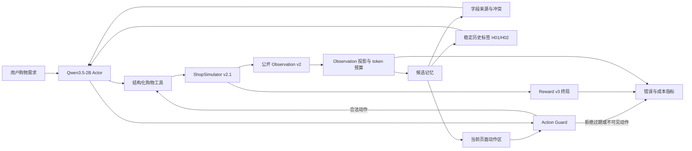

# 预算感知购物 Agent：简历与面试讲解

## 一句话介绍

基于 Shopping GRPO 改造长程购物 Agent，引入可追溯候选记忆、当前页面动作隔离和
轨迹级 token 预算，在 Qwen3.5-2B 的 40 个未见开发任务上观察到严格成功从 0/40
提升到 2/40，同时总输入 token 降低 20.0%。

## 简历项目名称

**Budget-Aware Shopping Agent｜长程购物智能体的候选记忆与推理成本优化**

## 简历描述

- 针对购物 Agent 在多页面搜索中遗忘候选约束、重复核验和引用过期商品控件的问题，
  设计只读取公开 observation 的可追溯候选记忆，保留字段来源与冲突，并用稳定历史
  标签和当前页面动作区隔离不可执行的旧商品标识。
- 在评测运行时加入累计输入 token 计量与每轨迹 100,000-token 上限，构建
  baseline、budget-only、memory-v4 三组固定任务配对实验，区分预算截断与候选记忆
  各自带来的影响。
- 在 Qwen3.5-2B 的 40 个未参与调参的开发留出任务上，memory-v4 取得 2/40 严格成功，
  两个对照均为 0/40；相对 baseline 将总输入 token 降低 20.0%、Guard 拒绝从 155
  降至 105、非法动作终止从 28 降至 21。
- 建立固定分母、数据哈希、任务重叠审计、Wilson 区间和配对 bootstrap 报告流程，
  通过 83 项相关测试并保存可复核的逐任务轨迹；明确单次 40-task 结果尚不构成统计显著
  或 Final-200 正式结论。

如果简历空间只够两条，保留第一条和第三条；如果岗位更看重工程规范，再加入第四条。

## 技术栈

Python、PyTorch、vLLM、Qwen3.5-2B、ShopSimulator、结构化工具调用、长上下文管理、
固定分母评测、paired bootstrap、Git、AutoDL、RTX 4090/4090D。

## 系统结构

候选记忆不是向量数据库，也不引入外部商品知识。它是一次轨迹内部的结构化工作记忆，
只整理 Agent 已经看过的公开页面证据。

## 1 分钟面试讲解

这个项目解决的是长程购物 Agent 的状态管理问题。基础模型在搜索、商品详情和规格页面
之间切换时，经常忘记之前核验过的约束，或者拿历史页面里的 ASIN 当成当前可点击控件，
导致重复搜索和非法动作。

我在原项目的评测运行时加入了候选记忆。它只读取模型真实看到的公开 observation，记录
候选商品的属性、证据来源和冲突。审计轨迹保留真实 ASIN，但模型只看到 H01、H02 这类
稳定历史标签；真正可以执行的动作单独来自当前页面，所以历史记忆不会伪造可点击按钮。
我还加入累计输入 token 统计和轨迹级硬上限，用三组实验拆分记忆与预算限制的作用。

在 40 个未参与调参的开发留出任务上，baseline 和 budget-only 都是 0 个严格成功，
memory-v4 有 2 个；同时总输入 token 比 baseline 低 20%，非法动作终止从 28 降到 21。
这个结果说明方法有工程价值，但样本仍小，bootstrap 区间包含 0，所以我把它表述为积极
的开发证据，不宣称统计显著。

## 3 分钟讲解顺序

1. **问题**：长程页面交互让上下文不断增长，模型会遗忘约束、重复核验并执行过期动作。
2. **基线现象**：10-task smoke 中 baseline 严格成功 0/10，9 个任务因非法动作过多终止。
3. **设计**：加入来源可追溯的候选记忆、稳定历史标签、当前动作区和累计 token 上限。
4. **关键修复**：最初模型直接复用历史 ASIN，Action Guard 会拒绝；拆分“历史证据”和
   “当前可执行状态”后，记忆可以辅助决策而不会冒充页面控件。
5. **实验**：先用 10 题选择 v4，再冻结剩余 40 题；设置 baseline、budget-only、
   memory-v4，所有任务、解码参数、环境和 Reward 保持一致。
6. **结果**：memory-v4 新增两个 gold purchase，总 token 降低 20%，Guard 拒绝减少 50，
   且没有 baseline-only 成功回退。
7. **边界**：40 题单次运行的区间仍宽；下一步应在训练侧接入、做多随机种子，并最终只
   在方法冻结后运行 Final-200 Clean。

## 常见追问

### 这和 RAG 有什么区别？

RAG 通常从外部知识库检索内容；这里没有外部知识库。候选记忆只压缩同一条购物轨迹中
已经观察到的商品证据，属于在线工作记忆和状态管理。

### 如何保证没有偷看答案？

记忆模块只接收公开 observation v2，不读取目标商品私有字段、Reward 标签或最终答案。
数据测试还检查了训练集、10-task 调参集、40-task 留出集和 Final-200 的 task_id 边界。

### 为什么不能把历史 ASIN 直接给模型？

历史 ASIN 对审计有用，但离开原搜索页面后不一定仍是合法控件。模型如果再次点击，会被
Action Guard 拒绝。项目在审计数据中保留真实 ASIN，在模型上下文中改用稳定标签，并把
当前页面允许的动作单独呈现。

### 为什么需要 budget-only 对照？

如果 memory-v4 同时使用 token 上限，只和无限预算 baseline 比较，就无法判断收益来自
记忆还是提前截断。Budget-only 使用相同上限但关闭记忆，结果 token 降低 10%，严格成功
仍为 0/40；memory-v4 则降低 20% 并取得 2/40，说明观察到的变化不只是预算限制。

### 2/40 是否太低？

绝对成功率仍低，这反映 2B 基础模型的工具能力有限。项目价值在于用同一模型、同一任务
和同一环境做受控改造，同时改善成功、成本和动作合法性。简历中应写“观察到 2/40 对
0/40”，不能写成“证明成功率显著提升”。

### 为什么没有直接做 GRPO？

先用推理期消融验证记忆表示和成本口径，可以在训练前发现协议错误并降低试错成本。
训练侧接入尚未完成，因此本分支不把上游 SFT/GRPO 结果算作自己的训练成果。

### 下一步怎么做？

先冻结当前实现，将记忆状态接入 SFT/GRPO rollout；再使用独立开发任务选择训练配置，
做多次重复运行，最后在不继续调参的前提下执行一次 Final-200 Clean。

## 不能写进简历的说法

- “成功率显著提升”：当前置信区间包含 0。
- “完成了 GRPO 训练优化”：本分支尚未执行训练侧改造。
- “Final-200 提升 5%”：40-task 开发留出不是 Final-200。
- “节省 49.9% token”：这是 10-task 内部 v2/v4 调参比较；对未见 baseline 的可信数字是
  20.0%。
- “解决了购物 Agent”：当前绝对成功率仍低，应强调受控工程改进和可复核评测。

## 可展示证据

- 方法与边界：[`PROJECT.md`](../PROJECT.md)
- 40-task 协议与结果：[`docs/dev-holdout-40.md`](dev-holdout-40.md)
- 机器可读摘要：[`experiments/budget_memory/summary.json`](../experiments/budget_memory/summary.json)
- 核心实现：`src/shopping_grpo/memory/candidates.py`
- 运行时接入：`src/shopping_grpo/evaluation/rollout.py`
- 三臂入口：`scripts/dev_holdout.sh`
- 配对统计：`scripts/compare_budget_memory_runs.py`
